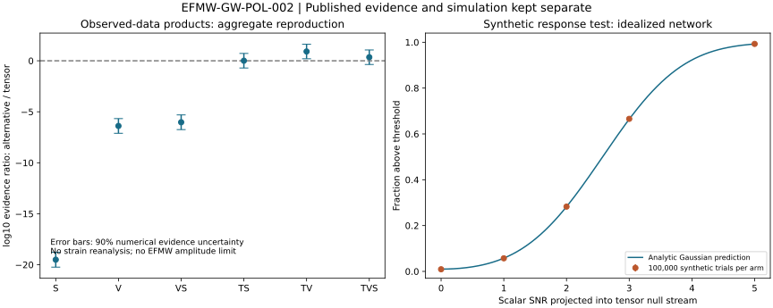

# GW-POL — Extra gravitational-wave polarization tests

**EFMW-GW-POL-002 · Matthew Chenoweth Wright / Monolithic LLC**  
Experiment: 30 October 2026. Paper and repository publication: 31 October 2026.

Reproduction of public LVK aggregate polarization evidence, an idealized synthetic detector-response check, and a conditional scalar-curvature coupling map for the proposed EFMW C1 action.

**32/32 numerical checks pass. This is not a fresh observed-strain search, an extra-mode detection, or experimental validation of EFMW.**

## Start here

- [Research paper](PAPER.md)
- [Standalone report source](index.html) — download and open locally in a browser; all assets are embedded.
- [Original experiment archive](EFMW-GW-POL-002-results.zip?raw=true)
- [Machine-readable results](results/results.json) and [aggregate table](results/aggregate.csv)
- [Conditional derivation](DERIVATION.txt) and [frozen computation protocol](protocol.json)
- [Paper published in enuminous/papers](https://github.com/enuminous/papers/blob/fdae3153c1dff5bb07846fe87e76107f7ece430a/EFMW-GW-POL-002-Extra-Gravitational-Wave-Polarizations.md)

## Main results

| Check | Result | Interpretation |
|---|---|---|
| Tensor-plus-scalar / tensor evidence | Bayes factor 1.0185246 | Essentially no preference |
| Published table reproduction | 36 rounded entries match | Recombination of released products |
| Upstream numerical macros | Byte-identical | Reproduction of numerical output |
| Synthetic noise-only crossings | 930 / 100,000 | Consistent with nominal 1% per-template threshold |
| Synthetic scalar at projected SNR 5 | 99,279 / 100,000 recovered | Ideal Gaussian calculation, not an HLV forecast |
| C1 coupling identity | 1,000 numerical checks | Conditional scalar-tensor calculation |



The five injection arms reuse the same 100,000 noise realizations. They are not 500,000 independent draws. The numerical evidence uncertainties do not include all instrumental or modeling systematics. No EFMW coupling bound can be inferred from the aggregate products alone.

## Reproduce

Use Python 3.12 and the pinned dependencies:

```sh
python -m venv .venv
. .venv/bin/activate
python -m pip install -r requirements.txt
python run.py
python build_report.py
```

`run.py` regenerates results and exits unsuccessfully if a numerical acceptance check fails. `build_report.py` generates `report.html`. The publication snapshot `index.html` is a byte-identical copy of the original report; after regenerating a report, copy `report.html` to `index.html` if updating that entry point.

The requirements record NumPy 2.3.5, SciPy 1.17.0 and Matplotlib 3.10.8. Exact environment details are in `results/results.json`. The public input archive is already included, so the analysis itself does not need data downloads.

## Evidence boundary

The official [POL release](https://dcc.ligo.org/LIGO-P2600410-v1/public), associated with [LIGO-P2500781-v17](https://dcc.ligo.org/LIGO-P2500781-v17/public), supplies aggregate evidences. Its inspected manuscript is dated 21 July 2026; journal acceptance was not verified in this study. The archive contains no strain, per-event likelihoods or scalar-amplitude posterior samples.

The synthetic calculation assumes a known sky direction and temporal template, three ideal randomly oriented equal-noise Michelsons, and independent Gaussian detector noise. It is not the LVK inference pipeline.

The [C1 candidate](https://github.com/enuminous/EFMW-Lagrangian/blob/83f9d2ec03e055c6cd09aa6359189161ad1571f6/candidate/CANDIDATE.md) is pinned to commit `83f9d2ec03e055c6cd09aa6359189161ad1571f6`. A viable source model, matter extension, background, masses, binary scalar charges and waveform remain required before the conditional coupling map can yield an observational bound. No complete Zoo execution or Lean proof of this study is claimed.

## Provenance and rights

The unchanged original experiment ZIP has SHA-256:

```text
29a65c122fb377221d15de9d847d651a6799f06f32ba268ccf550b979ed4e37a
```

`MANIFEST.json` covers files from the original experiment package; it does not list the later repository README, paper, entry point or ZIP. `repository-manifest.json` records publication-file hashes. `sources.json` and `pinned-sources.json` identify captured sources. The source collaboration manuscript itself is not redistributed.

LVK materials retain their stated CC BY 4.0 terms unless otherwise specified. The required acknowledgment is preserved in [ATTRIBUTION.txt](ATTRIBUTION.txt). EFMW sources remain attributed to Matthew Chenoweth Wright; no new license is assigned to them. AI assistance was used for computation and writing. No LVK affiliation or endorsement is implied.
